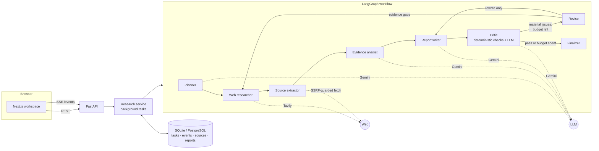
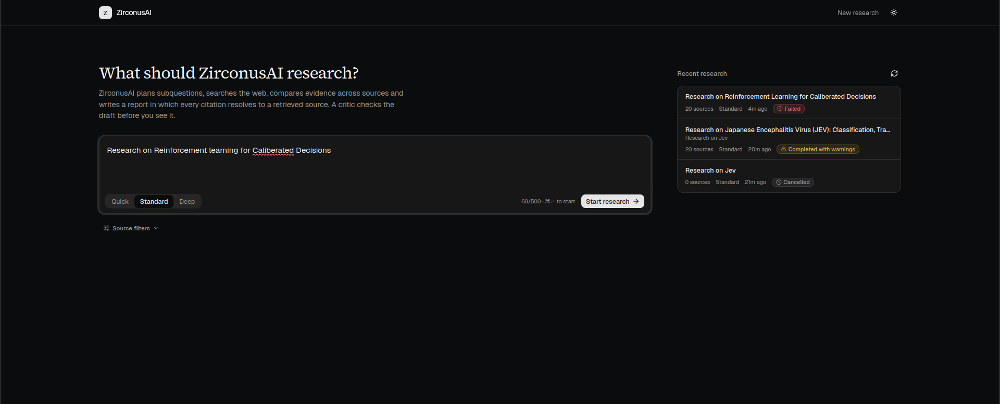
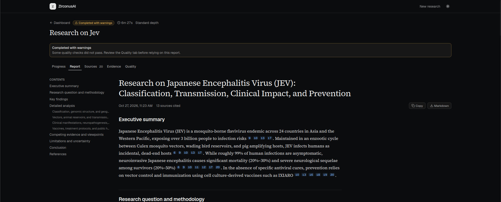
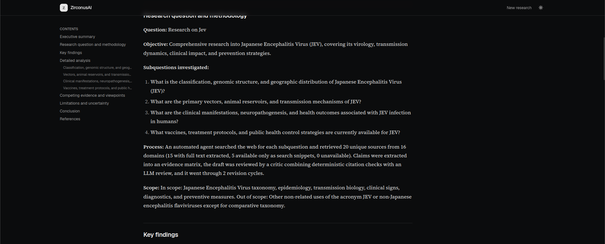
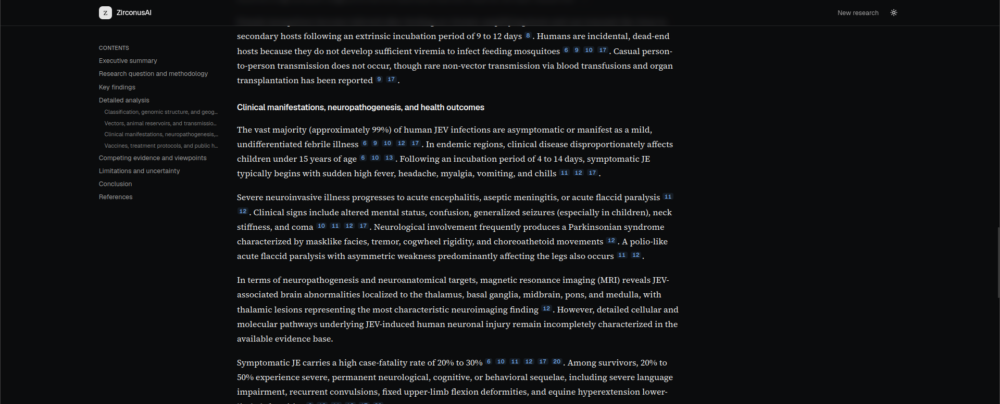
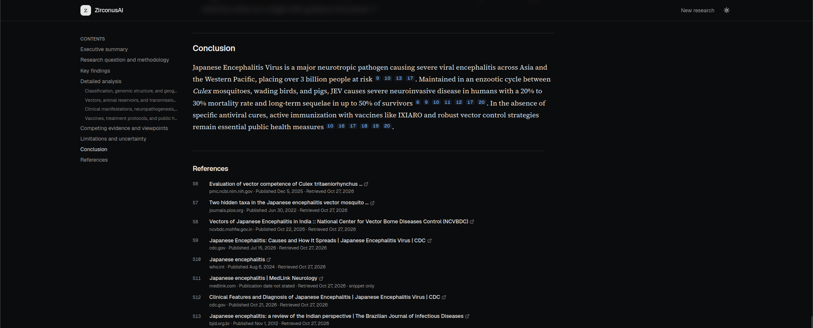

# ZirconusAI

**An autonomous research agent that plans, searches, verifies and writes cited reports.**

Ask ZirconusAI a question such as *"How is agentic AI changing data engineering?"*. It breaks the question into subquestions, searches the web, extracts and compares evidence across sources, drafts a Markdown report, and has a critic check the draft before you read it. Every citation in the final report resolves to a source the agent actually retrieved. Unsupported claims are flagged, sent back for revision, or reported as unresolved. They are never silently passed.

This is an agentic workflow with planning, tool use, self-critique and bounded revision loops, not a chatbot that summarises search results.

| Layer | Technology |
|---|---|
| Frontend | Next.js 16 (App Router), TypeScript, Tailwind CSS v4, shadcn/ui, react-markdown |
| Backend | FastAPI, Pydantic, SQLAlchemy (SQLite or PostgreSQL), Server-Sent Events |
| Agent workflow | LangGraph, LangChain |
| LLM | Google Gemini |
| Web search | Tavily |
| Page extraction | Trafilatura (with an SSRF-guarded fetcher) |

---

## Contents

- [Architecture](#architecture)
- [How citations are verified](#how-citations-are-verified)
- [Features](#features)
- [Getting started](#getting-started)
- [Using ZirconusAI](#using-zirconusai)
- [Configuration](#configuration)
- [API](#api)
- [Testing](#testing)
- [Evaluation](#evaluation)
- [Project structure](#project-structure)
- [Known limitations](#known-limitations)
- [Screenshots](#screenshots)

---

## Architecture



**Request flow**

1. The browser sends `POST /api/research`. FastAPI stores the task and returns `202` with its ID straight away.
2. The research service runs the LangGraph workflow as a background task. Each node writes progress events to the database.
3. The browser streams those events over SSE (`/api/research/{id}/events`) and draws the live workflow timeline. Because events are persisted, a refresh or reconnect resumes where it left off.
4. When the graph finishes, the finalizer stores the report, sources and quality assessment, and the UI loads them from the REST endpoints.

**Workflow nodes**

| Node | Responsibility | Output |
|---|---|---|
| Planner | Splits the question into 3–5 focused subquestions with search queries | `ResearchPlan` |
| Web researcher | Runs bounded, concurrent searches, normalises and dedupes URLs, assigns stable IDs (`S1`, `S2`, …) | `SourceRecord[]` |
| Source extractor | Fetches public pages (SSRF-guarded), extracts text with Trafilatura, falls back to search snippets and labels them as snippets | Sources with `extraction_status` |
| Evidence analyst | Extracts claims tied to source IDs. Claims citing unknown sources are dropped. Quotes not found verbatim in the source are removed | `EvidenceMatrix` |
| Report writer | Writes the Markdown report citing `[S#]` only. Model-written URLs and reference lists are stripped | Draft |
| Critic | Deterministic citation checks plus an LLM review. The LLM can add issues but cannot clear deterministic ones | `CriticResult` |
| Revise | Bounded by `MAX_REVISION_CYCLES`. Runs targeted follow-up searches or a rewrite driven by the critic's issues | Updated state |
| Finalizer | Strips invalid citations, renders references from stored source records, computes the quality assessment, persists the report | `ResearchReport` |

## How citations are verified

The core of the project is `backend/app/services/citations.py`. It is plain, testable code with no LLM involved:

1. **Citation IDs must resolve.** Any `[S#]` that is not a retrieved source is a high-severity issue. The finalizer removes it and records the removal.
2. **Figures must be traceable.** Numbers in a cited sentence (percentages, counts, years) must appear in the cited source text, matched as whole numbers, so "40" does not match "400".
3. **Factual-looking sentences need citations.** Sentences with figures or reporting verbs and no citation are flagged. Limitations, methodology and conclusion sections are exempt.
4. **Lexical support.** Near-zero overlap between a claim and its cited text is flagged. This is a weak signal because paraphrase is legitimate, so it only escalates for full-text sources with almost no overlap.
5. **Quotes are verified.** Evidence-matrix quotes must appear (near-)verbatim in the cited source.

The LLM critic then judges semantic support, overconfidence, contradictions, coverage and source quality. A valid URL is not proof that a claim is true. The quality panel says so, and LLM "assessments" are labelled as categories, not calibrated probabilities.

## Features

- **Research dashboard:** question input with validation, depth selector (quick/standard/deep), domain include/exclude and date filters, and a history of recent research with live status.
- **Live workspace:** workflow timeline built from persisted backend events, research plan, search and extraction counters, critic feedback per pass, revision count, warnings, an activity log, elapsed time, and real server-side cancellation.
- **Report reader:** table of contents, serif long-form typography, inline citation chips with source popovers, references rendered from validated source records, Copy and Markdown download.
- **Source explorer:** searchable, filterable table (full text, snippet only, unavailable, cited), plus a detail sheet showing metadata, the claims each source supports, verified quotes and extracted text.
- **Evidence and Quality tabs:** claims grouped by subquestion, conflicts and gaps, citation validity, coverage, unresolved issues, final critic findings, and API usage (LLM calls, tokens, searches, fetches).
- **Reliability:** timeouts, exponential backoff with bounded retries, bounded concurrency, an overall run deadline, a per-client rate limit on task creation, and tasks interrupted by a restart are marked failed rather than left "running".
- **Security:** SSRF protection (scheme/port allow-list, private/loopback/link-local/metadata IP blocking, DNS resolution checks, re-validation on every redirect, size and content-type limits), prompt-injection guarding (retrieved pages are delimited and treated as untrusted data), safe Markdown (no raw HTML), CORS restricted to configured origins, secret redaction in logs, and API keys that never leave the backend.

## Getting started

### Prerequisites

- Python 3.11+ (developed on 3.12)
- Node.js 20.9+ (developed on 22)
- A Gemini API key from [Google AI Studio](https://aistudio.google.com/app/apikey)
- A Tavily API key from [tavily.com](https://app.tavily.com) (free plan available; check current terms)
- Optional: Docker with Compose v2.24+

### 1. Add your API keys

```bash
cp .env.example .env
```

Open `.env` and fill in:

```
GEMINI_API_KEY=your-gemini-key
TAVILY_API_KEY=your-tavily-key
GEMINI_MODEL=gemini-3.5-flash
```

The keys are read only by the backend and are never sent to the browser. `.env` is listed in `.gitignore`.

### 2. Install dependencies (once)

```bash
# Backend
cd backend
python3 -m venv .venv
.venv/bin/pip install -r requirements-dev.txt    # or requirements.txt for runtime only
cd ..

# Frontend
npm --prefix frontend install

# Root helper (runs both servers together)
npm install
```

### 3. Run

**One command (recommended):**

```bash
npm run dev:all
```

This starts the backend on `http://localhost:8000` and the frontend on `http://localhost:3000`, with colour-coded `[backend]` and `[frontend]` logs. Ctrl+C stops both. You can also start them separately with `npm run dev:backend` and `npm run dev:frontend`.

**Or with Docker:**

```bash
docker compose up --build   # frontend :3000, backend :8000, SQLite on a named volume
```

Then open **http://localhost:3000**. Use exactly that address: CORS only allows the origin in `FRONTEND_ORIGIN`, so `127.0.0.1:3000` fails unless you add it.

To check the backend, open `http://localhost:8000/health`. It reports `ok`, or `degraded` with the names of any missing keys. The backend reads `.env` only at startup, so restart it after editing the file.

## Using ZirconusAI

1. **Ask a question.** On the dashboard, type a research question (up to 500 characters) or pick one of the examples.
2. **Choose a depth.**
   - *Quick*: up to 3 subquestions, fewest searches and LLM calls.
   - *Standard*: the default balance (about 4 LLM calls plus 2 per revision, and about 7 searches).
   - *Deep*: an extra subquestion and more sources.
3. **Filter sources (optional).** Under *Source filters*, restrict or exclude domains (for example `arxiv.org`) and set a publication date range.
4. **Start research and watch it run.** The *Progress* tab shows each workflow stage, the research plan, counters for searches and extracted pages, critic feedback for every pass, and an activity log. You can cancel a run at any time.
5. **Read the report.** The *Report* tab shows the cited report with a table of contents. Hover or click a citation chip to see its source, then jump to the full source record. Use *Copy* or *Markdown* to export it.
6. **Check the evidence.** *Sources* lists every retrieved source and whether its full text or only a snippet was used. *Evidence* groups claims by subquestion and shows conflicts and gaps. *Quality* shows citation validity, coverage, unresolved critic issues and API usage.
7. **Come back later.** Every run is saved. Reopen it from *Recent research* on the dashboard.

A run marked **Completed with warnings** finished, but some quality checks did not pass. Review the *Quality* tab before relying on that report.

## Configuration

All settings live in `.env` at the repo root (or `backend/.env`).

| Variable | Default | Purpose |
|---|---|---|
| `GEMINI_API_KEY` | (none, required) | Gemini access (backend only) |
| `TAVILY_API_KEY` | (none, required) | Tavily search (backend only) |
| `GEMINI_MODEL` | `gemini-3.5-flash` | Model used by every LLM node |
| `DATABASE_URL` | `sqlite:///./research.db` | Any SQLAlchemy URL; PostgreSQL works with a driver such as `psycopg` installed |
| `MAX_SUBQUESTIONS` | `4` | Subquestions for standard depth (quick uses ≤3, deep +1) |
| `MAX_SOURCES_PER_SUBQUESTION` | `5` | New sources kept per subquestion |
| `MAX_REVISION_CYCLES` | `2` | Hard cap on critic-driven revisions (0 disables) |
| `REQUEST_TIMEOUT_SECONDS` | `20` | Search and page-fetch timeout |
| `LLM_TIMEOUT_SECONDS` | `90` | Per LLM call |
| `MAX_RESEARCH_SECONDS` | `900` | Whole-run deadline |
| `MAX_CONCURRENT_RESEARCH` / `_SEARCHES` / `_FETCHES` | `2` / `3` / `5` | Concurrency bounds |
| `CREATE_RATE_LIMIT_PER_MINUTE` | `10` | Per-client limit on `POST /api/research` |
| `FRONTEND_ORIGIN` | `http://localhost:3000` | Allowed CORS origin(s), comma-separated |

The frontend has one setting, `NEXT_PUBLIC_API_BASE_URL`, needed only if the backend is not on `http://localhost:8000`. It is public by design.

If Gemini returns "high demand" or timeout errors, the model is temporarily overloaded on Google's side. Retry later or switch `GEMINI_MODEL` to another available Flash model.

## API

Interactive docs are at `http://localhost:8000/docs`.

| Endpoint | Method | Description |
|---|---|---|
| `/api/research` | POST | Create a task and return `202 {id, status}` immediately; the graph runs in the background |
| `/api/research` | GET | Recent tasks (`limit`, `offset`) |
| `/api/research/{id}` | GET | Status, plan, warnings, error, usage, elapsed time |
| `/api/research/{id}/events` | GET | SSE stream of persisted progress events |
| `/api/research/{id}/report` | GET | Final report (`409` while running, `404` if none was produced) |
| `/api/research/{id}/sources` | GET | Source records (available as soon as searching finishes) |
| `/api/research/{id}/cancel` | POST | Cancel a running task |
| `/health` | GET | Health and missing configuration |

Example request:

```json
{
  "question": "How is agentic AI changing data engineering?",
  "depth": "standard",
  "include_domains": ["arxiv.org"],
  "exclude_domains": [],
  "start_date": "2024-01-01",
  "end_date": null,
  "max_sources_per_subquestion": 5
}
```

**SSE protocol.** Each `event: progress` carries `{id, type, node, message, data, timestamp}`. Types include `queued`, `started`, `stage_started`, `plan`, `search`, `sources`, `extraction`, `evidence`, `draft`, `critic`, `revision`, `quality`, `warning`, and the terminal `completed`, `failed` and `cancelled`. The stream ends with `event: end`. Events are read from the database, so clients resume with the standard `Last-Event-ID` header or `?after=<id>`. The frontend reconnects with exponential backoff. Prompts and model reasoning are never streamed.

## Testing

```bash
cd backend && .venv/bin/pytest            # 83 tests, no network or API quota used
cd frontend && npm test                   # 28 Vitest + Testing Library tests
cd frontend && npm run lint && npm run typecheck && npm run build
```

External services are replaced by deterministic fakes (`backend/tests/fakes.py`), and HTTP clients are tested with `respx` and `httpx.MockTransport`. Coverage includes:

- **Backend units:** structured planner output, URL normalisation and dedupe, extraction failures and snippet fallback, SSRF blocking (including redirects and DNS answers that resolve to private IPs), evidence claims limited to known IDs, fabricated-quote rejection, invalid citation removal, unsupported-claim and wrong-figure detection, the LLM critic being unable to clear deterministic issues, revision-limit enforcement, gap-research routing, LLM timeout and outage handling, and failure states.
- **API:** submit, poll, report, sources, list, SSE format and `Last-Event-ID` resumption, malformed requests (`422`), unknown IDs (`404`), missing credentials (`503`), rate limiting (`429`), cancellation, persistence across restarts, and recovery of interrupted tasks.
- **End-to-end smoke:** `tests/test_e2e_smoke.py` boots a real Uvicorn server and drives it over HTTP and SSE with CORS, exactly as the browser does.
- **Frontend:** form validation, duplicate-submit prevention, backend error display, workflow-state derivation, citation popovers and navigation to source details, references, TOC, quality and warning states, SSE streaming and reconnection with `?after=`, and failed and not-found states.

## Evaluation

```bash
cd backend
.venv/bin/python -m eval.run_eval critic            # offline: deterministic critic on labelled cases
.venv/bin/python -m eval.run_eval critic --llm      # adds the Gemini critic (uses quota)
.venv/bin/python -m eval.run_eval research --limit 3 --depth quick   # real end-to-end runs
```

- `eval/questions.json` has 20 questions across technical documentation, science, business and current events.
- `eval/critic_cases.json` has 16 hand-labelled sentences (8 supported, 8 with deliberately inserted unsupported claims) against short synthetic source excerpts.
- `research` mode records completion rate, citation validity, subquestion coverage, source diversity, latency, LLM calls, tokens and searches to JSON and CSV in `eval/results/`. It also exports sampled cited sentences with their source excerpts to `*_claims_for_review.csv`. **Claim support must be labelled by a human.** The script does not compute it.

**Measured so far:** on the 16 labelled critic cases, the deterministic checks alone reached precision 1.00 and recall 0.625 (5 TP, 0 FP, 3 FN, 8 TN). The misses are semantic misattributions that share vocabulary with the source, which the LLM critic exists to catch. The `--llm` and `research` evaluation modes have not been run yet, so no results are reported for them.

## Project structure

```
backend/
  app/
    main.py, config.py, logging_config.py
    api/        routes.py, events.py (SSE), deps.py, rate_limit.py
    schemas/    research.py, evidence.py
    graph/      state.py, nodes.py, edges.py, workflow.py, prompts.py, llm_schemas.py, context.py
    tools/      search.py (Tavily), extraction.py (SSRF-safe fetch + Trafilatura), llm.py (Gemini), retry.py
    services/   research_service.py, report_service.py, citations.py
    db/         models.py, session.py, repository.py
  tests/        unit, workflow, API, e2e smoke, fakes
  eval/         questions, labelled critic cases, runner
  requirements.txt, requirements-dev.txt, pyproject.toml
frontend/
  app/          page.tsx (dashboard), research/[id]/page.tsx (workspace)
  components/   research-form, research-history, research-workspace, workflow-timeline,
                report-viewer, citation-link, source-explorer, evidence-panel, quality-panel, ui/ (shadcn)
  hooks/        use-research-events.ts (SSE with resume)
  lib/          api.ts, types.ts, schemas.ts (zod), citations.ts, research.ts
  tests/        Vitest suites
Screenshots/    UI screenshots used below
package.json    root scripts (npm run dev:all)
docker-compose.yml, .env.example
```

## Known limitations

- **In-process execution.** Tasks run as asyncio tasks in the API process (single worker). Status, events, sources and reports are persisted, but a task interrupted by a restart is marked failed, not resumed. A durable LangGraph checkpointer and a job queue would be the next step.
- **Heuristic checks.** The deterministic checks catch mechanical failures (wrong IDs, untraceable figures, missing citations), not every misattribution. Semantic support relies on the LLM critic, whose judgement is not guaranteed.
- **Extraction.** HTML and plain text only. PDFs, paywalled pages and JavaScript-rendered pages fall back to search snippets, which the UI labels.
- **SSRF.** Hostnames are resolved and checked before every request and redirect, but there is no IP pinning between the check and the connection (DNS rebinding remains a theoretical window).
- **Rate limiting** is in-memory and per process.
- **PDF export** is not implemented. Markdown copy and download are.

## Screenshots

### Dashboard
Ask a question, choose a depth, and reopen earlier runs from *Recent research*.



### Report
The finished report with a table of contents, run status and inline citation chips.



### Methodology
Each report states its question, objective, subquestions, process and scope.



### Detailed analysis
Every factual sentence carries citations to retrieved sources.



### Conclusion and references
References are rendered from stored source records, with publication and retrieval dates and a label on snippet-only sources.


